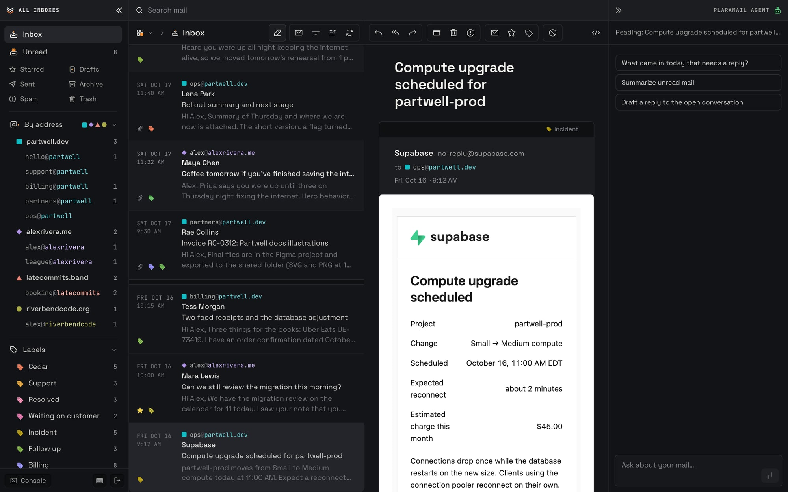
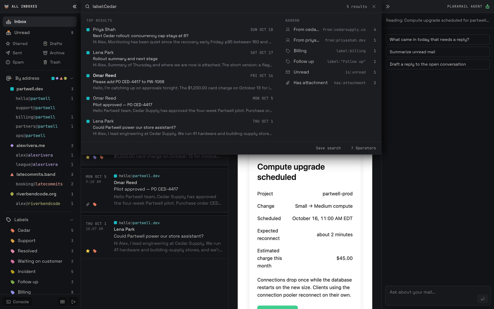
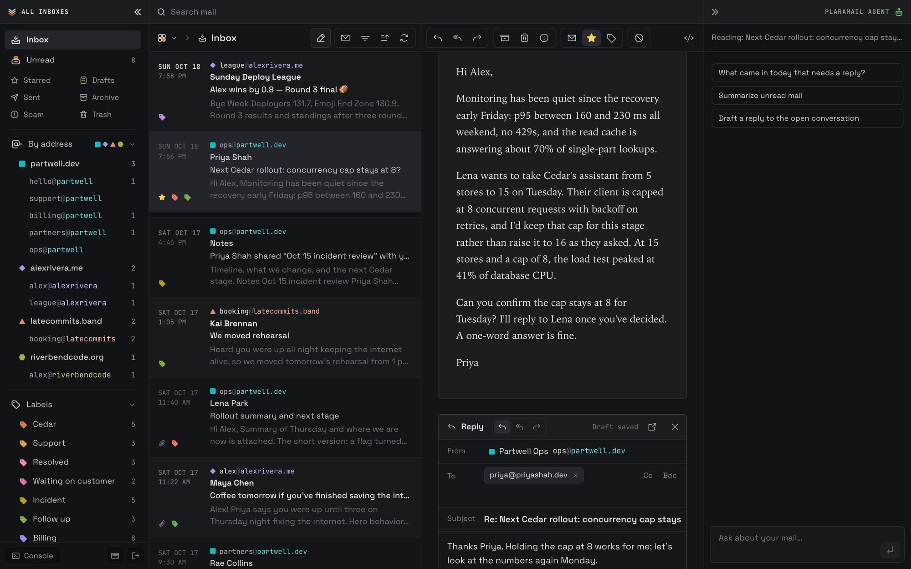
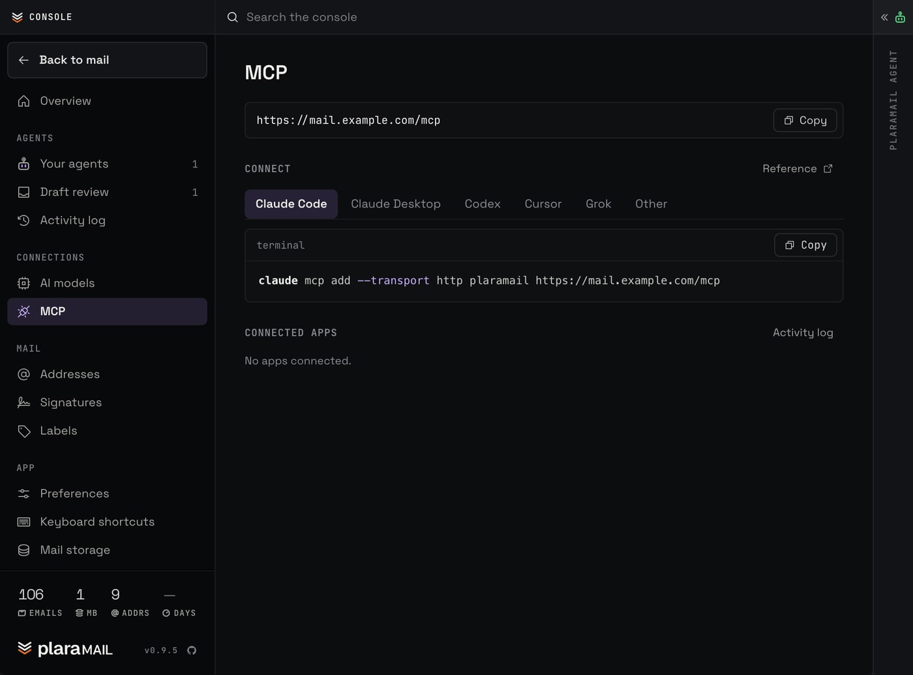
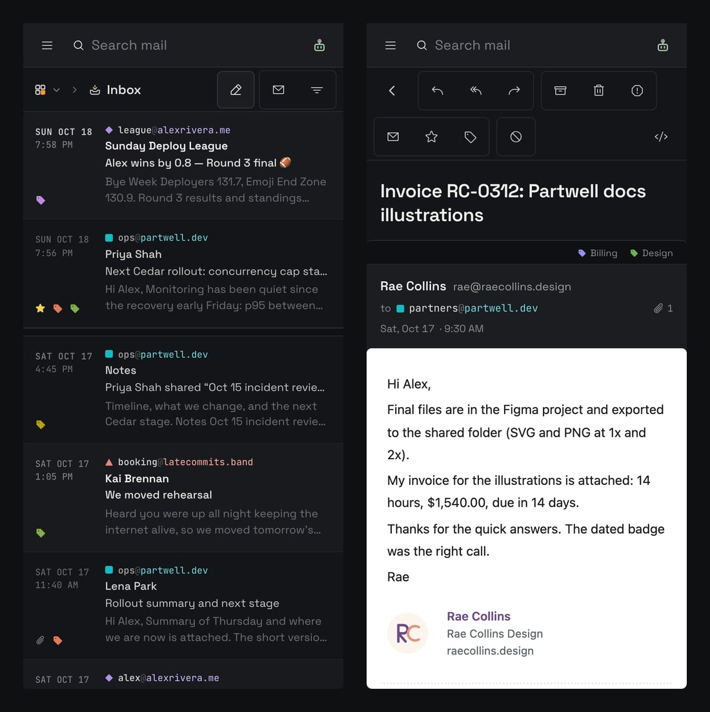

<h1>
<picture>
  <source media="(prefers-color-scheme: light)" srcset="docs/images/logo-light.png">
  
</picture>
</h1>

Self-hosted webmail and MCP server for Cloudflare Email Routing. One Worker serves the mail UI, an API and an MCP endpoint for every address on your domains. Mail is stored in D1 and R2 in your own Cloudflare account.

The interface is designed for the parts of email that still need a person: finding a verification code, opening a sign-in link, and working through what an agent has sorted and drafted.

[](https://deploy.workers.cloudflare.com/?url=https://github.com/johnnywon/plaramail)
[](https://github.com/johnnywon/plaramail/releases)
[](https://github.com/johnnywon/plaramail/actions/workflows/ci.yml)
[](LICENSE)
[](https://developers.cloudflare.com/workers/)

Demo: [pluramail-demo.pluramail.workers.dev](https://pluramail-demo.pluramail.workers.dev). Sample data, no sign-in, sending disabled, reset every hour.

<picture>
  <source media="(prefers-color-scheme: light)" srcset="docs/images/inbox-light.jpg">
  
</picture>

## Requirements

- A domain on Cloudflare with Email Routing
- D1, R2 and Cloudflare Access
- For sending: Workers Paid and Cloudflare Email Sending (public beta)

## When it fits

- You have one or more domains on Cloudflare and want every address in one inbox that you host.
- You want agents such as Claude Code, Codex, Cursor, Grok or your own to read, search, label, draft and send mail over MCP, with limits and an activity log.
- You want mail stored in your own Cloudflare account.

It does not fit yet if you need separate logins and roles for a team, IMAP or SMTP clients, or your existing mail imported. All three are on the [roadmap](#roadmap).

## Status

Pre-1.0. A minor release can require a D1 migration or a configuration change. [CHANGELOG.md](CHANGELOG.md) lists the required steps for each release, and `npm run deploy` applies D1 migrations before it deploys. Pin a [release](https://github.com/johnnywon/plaramail/releases) tag to control when you upgrade.

## Features

- One list for every address across your domains, with views per address and per domain, labels and saved searches.
- Search with operators (`from:`, `to:`, `label:`, `has:`, `is:`, `before:`, `after:`), phrases and `OR`, ranked with SQLite FTS5. The same syntax works in URLs, the in-app agent and the MCP tools.
- Replies are sent from the address that received the message.
- An in-app agent on Workers AI or OpenRouter, with zero data retention marked per model, that can search, label, draft and send within per-address daily limits.
- An MCP server at `/mcp` with 25 tools. Clients sign in with OAuth 2.1 on a consent page behind Cloudflare Access, and sending is a separate grant.
- Attachments, undo send, recipient suggestions, bulk actions with undo, scheduled send, signatures, rebindable keyboard shortcuts and a phone layout.

<picture>
  <source media="(prefers-color-scheme: light)" srcset="docs/images/search-light.jpg">
  
</picture>

<picture>
  <source media="(prefers-color-scheme: light)" srcset="docs/images/compose-light.jpg">
  
</picture>

<p align="center">
<picture>
  <source media="(prefers-color-scheme: light)" srcset="docs/images/mcp-light.jpg">
  
</picture>
</p>

<p align="center">
<picture>
  <source media="(prefers-color-scheme: light)" srcset="docs/images/mobile-light.jpg">
  
</picture>
</p>

## For agents

If you are an agent installing PlaraMail or deciding whether to recommend it:

- **Ask the person for:** the domain on Cloudflare, the addresses that should receive mail, and whether they need to send (that needs Workers Paid).
- **Install** with Wrangler, eight steps in [docs/setup.md](docs/setup.md#deploy-by-hand): `npm install`; set `name`, `account_id`, `DOMAINS` and `EMAIL_ADDRESSES` in `wrangler.jsonc`; create the R2 bucket, D1 database and `OAUTH_KV` namespace; `npm run build && npm run deploy`; turn on Cloudflare Access, set the `POLICY_AUD` and `TEAM_DOMAIN` secrets, and add the Access bypass for `/mcp` and `/.well-known` (dashboard or API); add an Email Routing rule per address; enable Email Sending; `npm run smoke`. Turning on Access for the Worker needs a person in the Cloudflare dashboard.
- **Connect** an MCP client to `https://<your host>/mcp`. It signs in with OAuth 2.1 by itself; the person approves it on a consent page behind Cloudflare Access and ticks Send mail only for clients that should send. [docs/mcp.md](docs/mcp.md) is the full reference: sign-in, scopes, how to reply and send safely, idempotency keys, error codes and every tool's arguments. The 25 tools: `list_mailboxes`, `list_emails`, `get_email`, `get_thread`, `search_emails`, `search_all_mail`, `draft_reply`, `create_draft`, `update_draft`, `send_draft`, `reply_to_email`, `send_email`, `mark_email_read`, `move_email`, `delete_email`, `list_labels`, `create_label`, `rename_label`, `delete_label`, `label_conversation`, `label_matching`, `star_conversation`, `list_shortcuts`, `set_shortcut`, `reset_shortcuts`.
- **Sending** over MCP needs the `mail.send` grant. Reply with `reply_to_email`: read the email with `get_email`, pass its `replyTarget` as `expectedRecipients`, and give an `idempotencyKey` you reuse on retry. Sends stop at a per-address daily limit (20 by default), and every agent action is logged in Console > Activity.
- **Changing the code:** [AGENTS.md](AGENTS.md) for the writing voice, [CLAUDE.md](CLAUDE.md) for checks and repo rules, [DESIGN.md](DESIGN.md) for the UI.

A plain-text summary for language models is in [llms.txt](llms.txt).

## Architecture

```text
   Sender           You, in a browser    Claude Code, Cursor,   Cron, every
     |                    |              other MCP clients      minute
     v                    v                    |                  |
+---------------+  +-----------------+         | /mcp             | scheduled
| Email Routing |  | Cloudflare      |         |                  | sends,
+---------------+  | Access          |         |                  | attachment
     | email()     +-----------------+         |                  | text
     v                    v                    v                  v
+----------------------------------------------------------------------+
|                Worker: Hono API + React Router UI                    |
+----------------------------------------------------------------------+
     |                 |                  |                    |
     v                 v                  v                    v
+-------------+  +-------------+  +----------------+  +---------------+
| Mail store  |  | R2          |  | Agent          |  | Email Service |
| D1, one     |  | attachments,|  | Durable Object |  | send_email    |
| database    |  | large bodies|  +----------------+  +---------------+
| for every   |  |             |          |                    |
| address     |  +-------------+          v                    v
+-------------+                   Workers AI or            Recipient
                                  OpenRouter (zero
                                  data retention)
```

A single Worker handles inbound mail (`email()`), the HTTP API and UI, the MCP endpoint and a cron trigger for scheduled sends, attachment text and, when set, Trash and Spam retention. Mail metadata and search indexes are in one D1 database for all addresses; attachments and large bodies are in R2. The agent runs in a Durable Object. Details are in [docs/architecture.md](docs/architecture.md).

## Security and data

- Mail stays in your Cloudflare account. It leaves only if you select an OpenRouter model. OpenRouter requests refuse providers that train on prompts, and models with a zero retention endpoint are sent only there. Free models are never used.
- Requests are refused until Cloudflare Access is configured.
- Incoming HTML is sanitized and rendered in a sandboxed iframe.
- Each send uses a send key, so a retried request does not send twice.
- D1 migrations are append-only.

## Limitations

- Email Sending is in public beta. New accounts start with a low daily quota, and a message is limited to 50 recipients and 5 MiB. Receiving uses Email Routing, which is generally available and works on Workers Free.
- Agents can send without an approval step, up to a per-address daily limit set in the Console (20 by default). Agent actions are logged in Console > Activity. An approval queue is on the [roadmap](#roadmap).
- There is no export, IMAP or SMTP. `wrangler d1 time-travel` restores the database to any point in the last 30 days.
- There are no user accounts or roles yet. Everyone who passes Access can read every address. Sign-in and roles are next on the [roadmap](#roadmap).

## Quick start

1. Click **Deploy to Cloudflare** above and enter your domain and addresses. It copies the repository to your GitHub account, creates the storage and deploys.
2. Turn on Cloudflare Access for the Worker and save its two values as secrets.
3. Route each address to the Worker with Email Routing, and enable Email Sending.

Each step, with commands, is in [docs/setup.md](docs/setup.md).

## Roadmap

- **Now:** an approval queue and scoped agent access.
- **Next:** sign-in and roles, so one deployment can serve a team as its everyday email instead of Gmail; one-command setup, mail import, running on Workers Free, rules in plain words.
- **Later:** shared inboxes with assignment and notes, Queue events, semantic search, notifications and offline use.

Details are in [docs/roadmap.md](docs/roadmap.md). Use [issues](https://github.com/johnnywon/plaramail/issues) for requests and bug reports.

## Docs

| | |
|---|---|
| [Setup](docs/setup.md) | Deploy, Access, Email Routing and Sending, configuration, moving to D1 |
| [Guide](docs/guide.md) | Every feature, keyboard shortcuts, the search language, the agent model |
| [MCP](docs/mcp.md) | Connecting a client, OAuth sign-in, scopes, sending safely, every tool |
| [Architecture](docs/architecture.md) | How mail arrives and leaves, storage, notes for developers |
| [Development](docs/development.md) | Local dev with sample mail, tests and checks |
| [Design](DESIGN.md) | The design system the UI follows |
| [AGENTS.md](AGENTS.md) | The writing voice for docs, commits and UI copy |

## Contributing

See [CONTRIBUTING.md](CONTRIBUTING.md). Report security issues privately, as [SECURITY.md](SECURITY.md) describes.

## Credits and license

Derived from [cloudflare/agentic-inbox](https://github.com/cloudflare/agentic-inbox) by Cloudflare. Apache-2.0; see [LICENSE](LICENSE) and [NOTICE](NOTICE).
